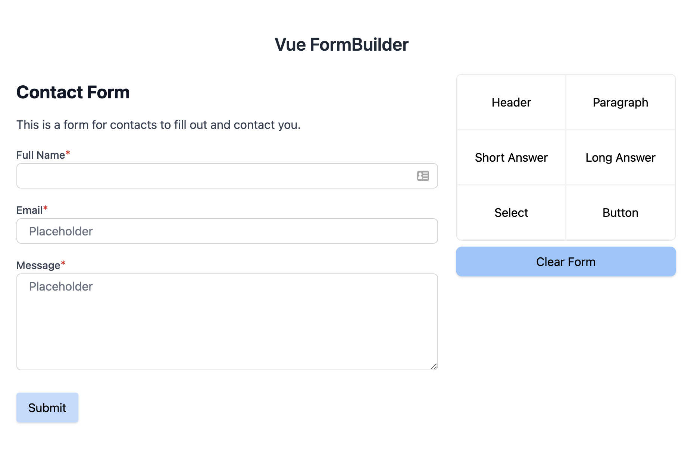
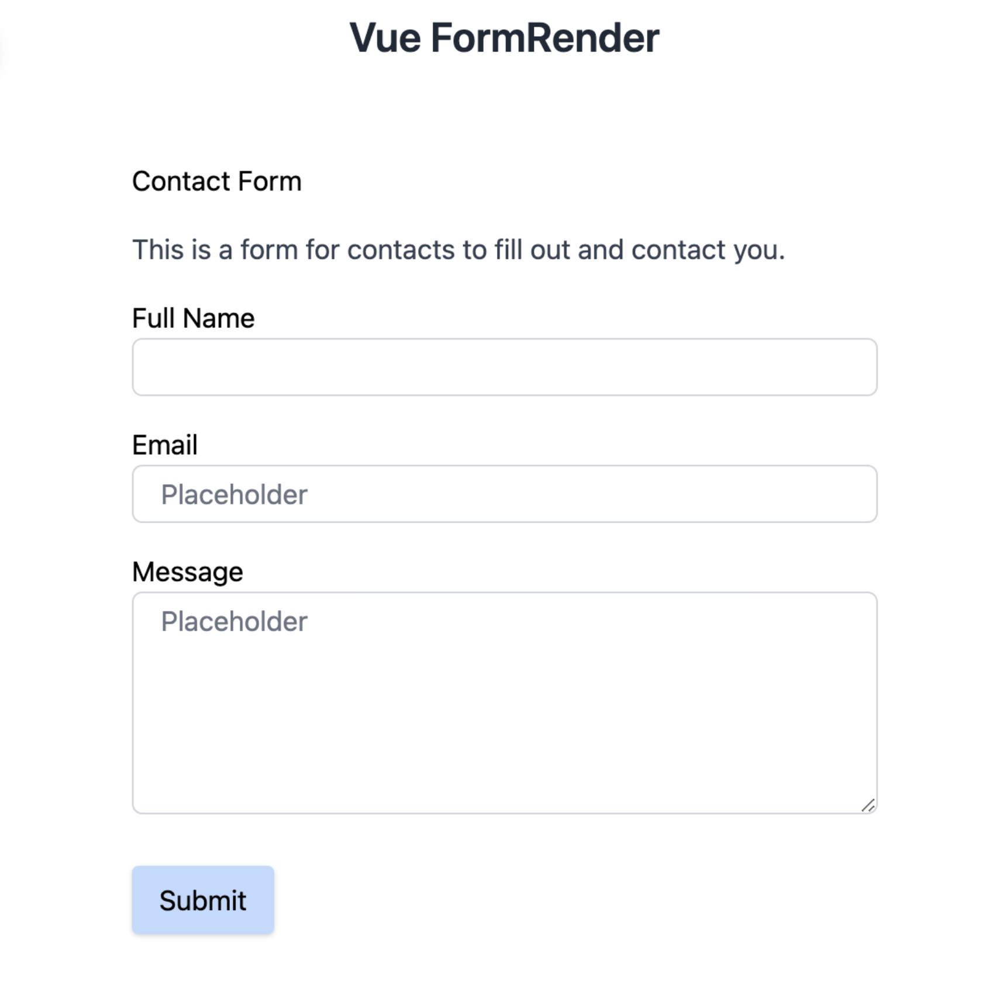

# Vue 3 FormBuilder with TailwindCSS v4

A modern Vue 3 form builder component using the Composition API and TailwindCSS v4. Build dynamic forms with drag-and-drop functionality and render them from JSON configuration.

## ✨ Features

- **Vue 3 + Composition API**: Modern Vue.js with reactive composition functions
- **TailwindCSS v4**: Latest Tailwind with Oxide engine for better performance
- **TypeScript Ready**: Full TypeScript support with proper prop definitions
- **Vite Build System**: Fast development and optimized production builds
- **Multiple Field Types**: Headers, paragraphs, inputs, textareas, selects, and buttons
- **Form Validation**: Built-in required field validation
- **JSON Export/Import**: Save and restore form configurations

## 📦 Installation

```bash
npm install @jringeisen/vue-formbuilder
```

## 🚀 Getting Started

### Vue 3 Setup

**Option 1: Global Registration**
```javascript
import { createApp } from 'vue'
import VueFormBuilder from '@jringeisen/vue-formbuilder'
import '@jringeisen/vue-formbuilder/style.css'

const app = createApp(App)
app.use(VueFormBuilder)
app.mount('#app')
```

**Option 2: Component Import**
```javascript
import { FormBuilder, FormRender } from '@jringeisen/vue-formbuilder'
import '@jringeisen/vue-formbuilder/style.css'

export default {
  components: {
    FormBuilder,
    FormRender
  }
}
```

### Using FormBuilder

```vue
<template>
  <form-builder @form="handleFormUpdate" />
</template>

<script setup>
import { ref } from 'vue'

const formData = ref([])

const handleFormUpdate = (formConfig) => {
  formData.value = formConfig
  // Save to database, localStorage, etc.
}
</script>
```

### Using FormRender

```vue
<template>
  <form-render :form-json="savedFormConfig" />
</template>

<script setup>
import { ref } from 'vue'

const savedFormConfig = ref([
  // Your saved form configuration array
])
</script>
```

## 🎨 Styling

The package includes TailwindCSS v4 styles. You have two options:

1. **Import the built CSS** (recommended):
```javascript
import '@jringeisen/vue-formbuilder/style.css'
```

2. **Use your own TailwindCSS setup** and import the raw components.

# ToDo
- [X] Convert to a package
- [X] Add a form render component
- [ ] Add more field options
- [ ] Make fields draggable



